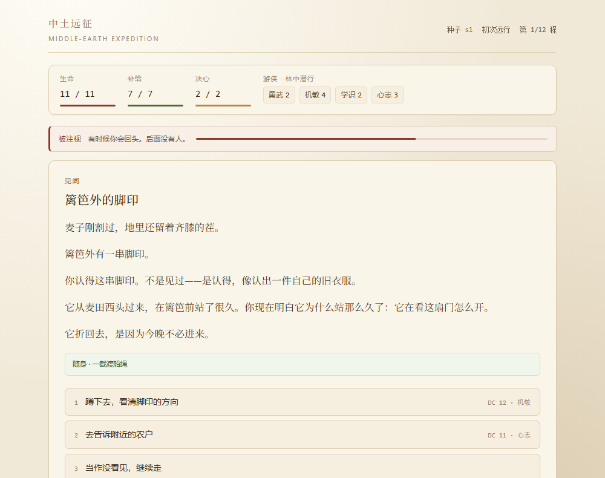
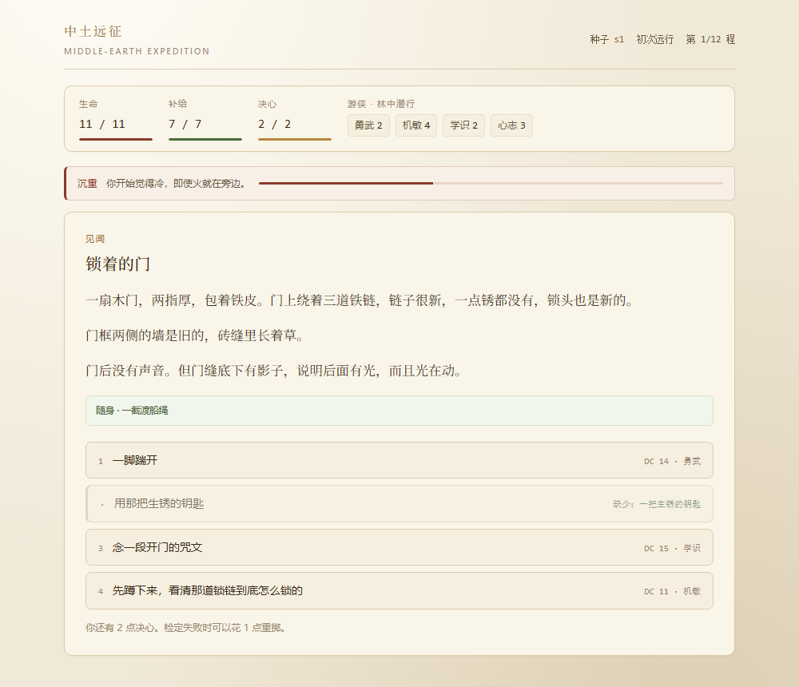
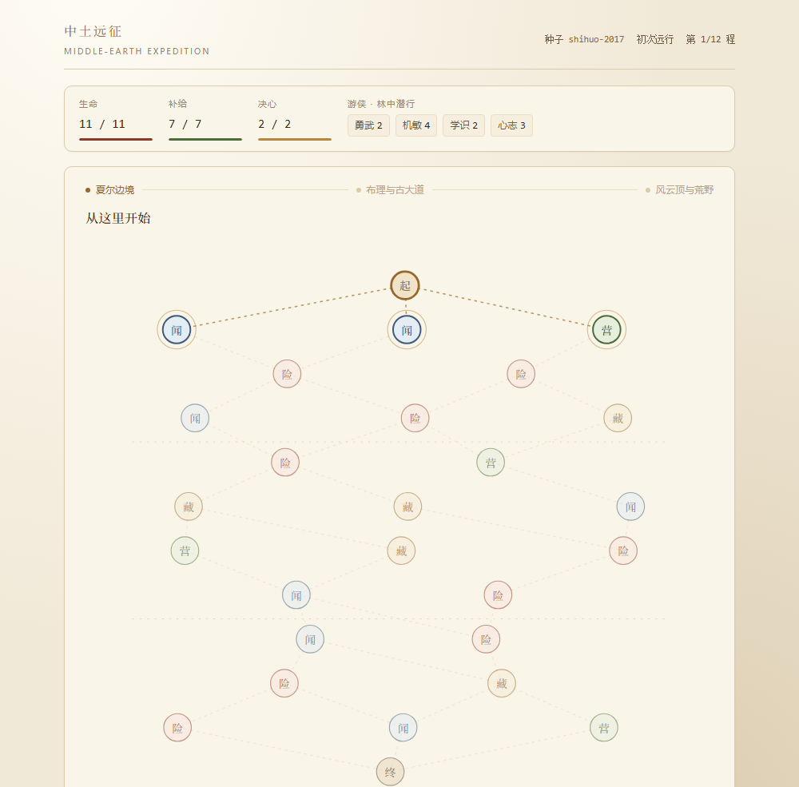

# 中土远征

> 一个纯文字的中土跑团。单文件 HTML，打开就能玩，不用安装。

**在线试玩 →** https://gtx950l.github.io/middle-earth-expedition/

---

## 这是什么

十二程路。从夏尔出发，经布理，穿过古大道，到风云顶以西的荒野。

每到一个节点你会遇到一件事：雾里的马蹄、卡在树上的羊、一扇锁着的门。你可以观察、可以硬来、可以花掉身上带着的东西，也可以什么都不做，继续走。

掷骰决定成败，但**失败不一定结束，成功也不一定免费**。

---

## 几个还算有意思的地方

### 一、阴影会改写你看到的文字

阴影是一条 0–8 的暗线。它不是血条，界面上不显示数字，只显示一句话：

`未染 → 微暗 → 沉重 → 被注视 → 模糊 → 将熄 → 它的`

到 3 点，同一段路会换一种语气写。同一串脚印：

> **阴影低**：就在篱笆外侧的泥地上，有一串脚印。比人的大一圈，比马的浅得多。它从麦田西头过来，在篱笆前停住了，站了很久。然后它折回去了。没有进门。

> **阴影高**：篱笆外有一串脚印。**你认得这串脚印。不是见过——是认得，像认出一件自己的旧衣服。** 你现在明白它为什么站那么久了：它在看这扇门怎么开。它折回去，是因为今晚不必进来。

事实没变，变得是你和这件事的关系。

到 8 点，路会当场停下，不再等你走到结算才改判。屏幕上只剩两个选项：不去想了，继续走（**你到了那里，然后停住了**）；或者把出发时别人叫你的名字再说一遍——花光全部决心、再赔 3 点生命，阴影退回 5，接着走。一局只有一次。

再深一点，阴影不再只是多给一条路，它开始**拿走**一条。

被拿走的总是最温和的那个：「不惹麻烦，绕道走」「当作没看见，继续走」。它不消失，而是划掉、留在原位，下面多一句：

> 你本来可以那么做。你记得有这么一条路，但已经找不到入口了。

阴影 ≥4 夺走 1 个，≥6 夺走 2 个，≥7 时温和的选项几乎都没了。但无论多深，至少给你留两个能点的选项——它拿走的是「本来不必这么做的自由」，不是让你走不下去。判定由种子派生，同一颗种子每次都一样。

阴影不是单向闸门。地图上有「记起自己的名字」：停下来，花 1 点决心和 1 点补给，阴影 −2；到「模糊」之后还要再赔 2 点生命。每局两次，阴影不到 2 时按不动，次数用完了按钮会自己暗掉。以前一到 7 每层还会自动再 +1，进了这个区间就必然滑到 8，中间没有任何能做的事——那段自动滑坡已经拆掉。代价写在按钮上，点亮「破阵」也不会被减免：那是主动付出的代价，不是受到的伤害。

### 二、同一件事有四种解法

一扇锁着的门：

| 解法 | 代价 |
|---|---|
| 一脚踹开 | 勇武检定。成功但动静很大，整条巷子都听见了 |
| 用别处捡到的钥匙 | 免检定，消耗钥匙 |
| 念开门的咒文 | 学识检定。门开了，阴影 +1 |
| 蹲下来看清那道锁链 | 机敏检定。成功后**换一个题目** |

第四种是重点。看清之后你会发现：链子是新的，锁也是新的，但链子只是绕在门上，两头扣在一个锈断的铁环上。

**门根本没锁。是门后有把椅子顶着。**

难题自己消失了。

缺凭证的选项会显示出来，但是灰的，写着「缺少：一把生锈的钥匙」。你会知道自己错过了什么。

### 三、装备带得回来，也真的会碎

局内捡到的装备当场生效，常驻的「随身」条会把它一件件列出来。以前能不能进军械库只看结局，倒下或堕影基本等于白捡——200 局连续模拟里捡到 188 件、最终只攒下 16 件藏品，42% 的局一件都没捡到。v0.6 把这条链拆成三步：

- **收好**：每局 2 次，花 1 点决心把一件随身物裹进行囊最底层。收好的东西在通关、撤退、倒下时必定带回，也不占「回头只带一半」的额度。决心同时用来重掷检定，所以这是个真选择
- **掉落**：空着手进「藏」节点必定翻出一件；之后仍按品质权重抽，随身上限 6 件
- **入库**：重复藏品不再被静默吞掉——带回的强化更高就直接升级，否则按品质折成材料。结算页逐项写明「新藏品 / 强化 / 折成材料 / 军械库现有几件」，不再只说一句「已经存入」

只有一个例外：**堕入阴影时什么都带不走**，收好的也一样。这是结局，不是运气；到 8 之前还有两次「记起名字」和一次抗争可以自己把阴影压回去。

「代价成功」（刚够 DC）时，会先碎没收好的战利品，再碎你身上的，收好的排在最后——玩家付过的决心不作废。+1 以上降一级，+0 直接销毁——**永久**，并且局外装配栏会同步清空，不留一件已经不存在的「幽灵装备」。

你可能因为一次「差一点」，失去带了三局的传家宝。

同一批 200 局改成「会收好」的玩法重跑：掉落 266 件、带回 166 件，重复的部分折出 330 份锻造材料；第 10 局军械库里已有 8 件，而改动前跑满 200 局才攒到 16 件。

### 四、每局最多两次安静

10 条「夜话」，营地或路上触发，每局最多 2 条。

这些事件不掷骰。选项问的是「你把注意力放在哪」：

- 想温暖的事 → **决心 +**，但阴影不减（这是回避）
- 想失去的人 → **决心 −**，但阴影 −（直视让侵蚀退一点）

你要决心，还是要阴影下降。不能两个都要。

其中一条是「想写一封信」。真的写下来，走到终点时结算会多一段。**没有任何数值奖励**，故意的。

### 五、八个出身，越玩开得越多

游侠 / 盾卫 / 学士 免费。矮人 / 精灵 / 洛汗骑手 / 霍比特人 靠声望解锁。无籍者要通关三次。

不是纯数值：

- **矮人**：锻造半价，开局带「铁匠的斧」。锻造是营地里的局外操作，半价按**上一次出门的出身**判定，军械库页会写明当前是谁的手艺
- **精灵**：学识永久 +1，开局记得一句精灵语暗号
- **洛汗骑手**：每层首次勇武 +2，补给上限 −1
- **霍比特人**：机敏 +2，决心上限 +1
- **无籍者**：没有任何加成，但结算声望 +40%

### 六、结算会记得这一局发生过什么

倒下、撤退、走完全程、堕入阴影，各自有一段**回响**。

它不是战报。里面只写这一局真正发生过的事。局内埋了 19 类痕迹：写信、立誓、捡到与碎掉的装备、把某件东西收进行囊、把私事又往前推了一步、路上遇见并带上一个人、检定失败、代价成功、决心重掷、补给见底、被追上、阴影跨阶段、跨地区、看清一道障碍、记下与用掉的凭证、第一条被划掉的温和选项，以及停下来念过一次名字、到顶上又说过一次名字。没发生过的事不写，凑不够也不硬凑。

候选痕迹按分量排序，**结局会抬高相关的那几条**：倒下的人记得那次没成，堕入阴影的人记得第一条被划掉的路，通关的人记得立过的誓，回头的人记得路是从哪一程换了名字。每局只取两条。

> 第 8 程，「关了的门」。你试过「喊住他，说好话」，没成。
>
> 那之后你没有再试第二次。
>
> 第 5 程，路从「夏尔」换成了「布理」。名字换过一次，脚步没有。
>
> 「沉重」那天之后，你回头看的次数变少了。
>
> 路是从夏尔那头数过来的，数到第 8 程停了。

同一颗种子、同样的选择，回响就一样。最近一次 300 局模拟里出现了 264 种不同的回响。

### 七、每一步都是抉择

以前六成的落脚点只有一条可走的路，多分叉里还有四分之一两端是同一类型——等于选了跟没选一样。现在除了通往唯一终点的那一层，每个节点至少给两条路，且两条路类型不同；地图页把每条路的确定代价摊开写：

| | 路标 | 代价 |
|---|---|---|
| 险 | 有人挡在路上，走过去会有人记得 | 声望 +1（风险换收益）|
| 藏 | 拿得走，也要留一点在原地 | 阴影 +1 |
| 营 | 能歇一晚，火边把气缓过来 | 无额外代价 |
| 闻 | 会听见一件事，未必需要回答 | 无额外代价 |

路标写什么，进那个节点就真的兑现什么：`PATH_COST` 一张表同时喂界面和引擎，不会出现说明说一套、代码做一套。回归脚本对 200 张图、4538 个分叉节点逐个核过保底、类型互异与连通性。

难度也不再是断的。以前每档只挂自己的修正，第 6 档把 4/5 档的惩罚全丢了，通关率反而比第 4 档高得多。现在六档从第一档起累积：DC +1 → 补给上限 −1 → 荒野段追踪检定与路耗 +1 → 营地恢复减半 → 禁退 / 伤害 +1 / 终局 DC 16。稳健策略下每档 120 局的通关数依次是 93 / 91 / 77 / 43 / 32 / 20；`node tests/diag.js` 会在曲线断掉时直接报错。

### 八、这一趟有个缘由

以前一局里平均只遇到 8 件事，超过一半的选项既不要付出也不给回报，走完只留一段回响——**选择不留痕**。v0.7 给每局一条由种子派生的私事：临走时有人托你带一句话、一袋种子、一张画着记号的旧地图，或者只是让你替他看一眼东边。

它落在第 2、5、8 程（那一程若正好是秘藏或终点，就顺延到下一个落脚点），替换掉那一程的随机事件。每段只问一件事：**你愿意为它付什么**。两条推进的路各要一样东西（补给、决心、生命，或者阴影 +1），第三条是「算了，放下」。私事不掷骰——该不该继续，不该由骰子决定。

三处让它不只是三段新文本：

- **正文记得你走过哪里**。后面两段会把这一局真实遇到过的事件名写进来（「来路上「老磨坊的灯」那一处还记着」），还会引用你第几程第一次为它停下；「一袋种子」更会根据你有没有晾干它，换掉后面的正文和落点
- **阴影会拿走「放下」**。到 4 点以上，最温和的那条路被划掉，只剩两条付代价的路：越走越深，连把一件事放下都做不到了。推进的选项不会被误划——它们是主动付出，不是退让
- **办没办成有落点**。推满三段给声望与材料，推两段给一半，放下或没走到一分没有；结算页写明结果，回响里也多一条属于这条线的候选痕迹。那句话会带上你最后点过的选项和这一局真实遇过的一件事，所以同一条私事在不同局里不会长成一个样。堕入阴影的人什么都带不走，私事也一样

界面上有一条常驻的「这一趟还带着一件事」，写明进度和下一次它找上来的程数，不用自己记。

### 九、有个人跟你走了一段

第 4 程起，路上会遇上一个人：火边的猎户、背箱子的行商、跟着你的孩子、只剩半边甲的老兵。你可以让他跟着，也可以各走各的——这一局只有这一次，错过就没有别人了。

带上之后，界面上多一条「同行」，写着他的名字和两格信任。每两个事件，事件页底部会多一个「让他来」：猎户认得少走半天的路（补给 +2）、行商箱子里有别人正缺的东西（材料 +2）、孩子认得墙上的字（决心 +2）、老兵替你挡一下（生命 +2）。用一次少一格，两格用完他就走了，走了不能叫回来。

用不用是个真选择：用两次，这一局多拿 4 点资源；一次不用，他会陪你走到最后，结算多 4 点声望——他愿意再跟你走一段。结算回响会写他还在、没派上用场，或者在第几程离开。

相遇本身不掷骰。他不是道具，不会替你决定该走哪条路。

### 十、路上有些不必赢也不必输的事

一局平均只有八个事件，几乎每个都在要资源、加阴影、逼你做取舍。走到后面，人会有点累——不是难，是紧。

v0.9 在事件池里加了 12 件「闲事」：跟着你的狗、学人说话的鸟、不肯过桥的羊、路边的鞋、像脸的石头、雨停时那块晒暖的石头、火边的歌、煮糊的粥、数星星、用故事换干粮、补一个扣子、一把晒干的苹果。

它们不掷骰、不推进主线、不扣资源。大多数只给一点决心或补给，有的什么都不给，就是让你站一会儿。每局最多遇上两件，不会挤掉正事。

三件闲事在阴影深时会变味：狗跟的是你，还是你身上那股味道；歌你只记得那两句；数星星数着数着，发现自己在数别的东西。正文不改，只在末尾多一句——和别的事件一样。

这类事不给成就，也不进回响。它们只是让这条路像一条真的路：有人经过，有东西长着，有一顿饭煮糊了。

---

## 地图

12 层节点图，三个地区，每区 4 层。节点分险、闻、营、藏四类。除最后一程外每个分叉至少两条路、类型互异，进「险」+1 声望、进「藏」+1 阴影，地图页会先写明（见「七、每一步都是抉择」）。

种子显示在顶部——同一个种子会生成同一张图，**连事件序列都一样**。顶部有「今日挑战」，用当天日期做种子。

同一条通用事件，在三个地区不是同一段文字。断桥在夏尔是农人自己钉的木板，在布理是能过两辆车的古大道木桥，在荒野则断在一条干河上。13 条通用事件各有 3 版正文（共 39 段），只换正文，选项、数值、条件和事件链一概不动；阴影够深时，整篇改写优先于地区版——地方的气味会被吞掉。

另外 24 条通用事件**刻意**不写地区版，不是没写完：

| | |
|---|---|
| 9 条夜话 | 独白是心里的路，本就不该有地点 |
| 3 条阴影专用 | 阴影够深时地方气味会被吞掉，给它加地名是自相矛盾 |
| 4 条多解障碍 | 「看清之后」的揭示与解法叙事绑在同一扇门上，换地名就接不上 |
| 2 条凭证事件 | 结果文本写死了「钥匙掉在泥里」「这钟比这座村子老」，荒野里没有泥也没有村子 |
| 6 条路上的闲事 | 狗、鸟、羊、煮糊的粥，谁家门口都能发生；绑上地名反而窄了 |

这五类由回归脚本按 id 前缀与分组锁住，误加地区版会直接报错。

---

## 操作

- 电脑：双击 `index.html`，或者打开在线地址
- 手机：**建议用系统浏览器**（Safari / Chrome），不要用微信内置浏览器
- iPhone 可以「添加到主屏幕」，当独立应用全屏玩

## 存档

进度存在浏览器本地（`localStorage`）。刷新会回到当时那一屏（地图 / 事件 / 检定 / 阴影终局），不会退回标题页，但：

- iOS Safari **七天没打开**，可能被系统清掉
- 清缓存、无痕模式会丢
- 换设备不共通

营地页底部有 **导出存档码**：复制出来存到备忘录，换设备时粘回去。

只包含局外进度（声望、天赋、军械库、出身），**不含当前这一局**——换设备重开一局代价很小，而恢复局内状态容易出坏档。

---

## 开发状态

v0.9，能完整玩通。

| | |
|---|---|
| 事件 | 161 条（夏尔 36 / 通用 37 / 布理 40 / 荒野 48）|
| 分支结果 | 587 段 |
| 通用池地区版正文 | 39 段，覆盖 13 条通用事件 |
| 路线选择 | 200 张图 / 4538 个分叉节点全部 ≥2 条路且两端类型互异 |
| 路径代价 | 险 声望 +1 / 藏 阴影 +1；路标与引擎共用一张表 |
| 出身 | 8 个 |
| 难度 | 6 档，修正从第一档起累积，通关率单调递减 |
| 天赋 | 24 节点（一半改写规则，不是加数值）|
| 规则接线 | 24 天赋 / 8 出身 / 6 难度，逐条有行为断言，没有「写了描述却没接线」的条目 |
| 装备 | 20 件 / 5 槽位 / 强化 +0 ~ +5 |
| 装备带回 | 收好保底（1 决心 / 每局 2 次）、空手秘藏必掉、重复带回折材料、+0 销毁清装配栏 |
| 事件链 | 8 条 |
| 多解障碍 | 9 处，5 类解法 |
| 阴影改写 | 36 条整篇替换 + 45 条注脚 |
| 阴影对抗 | 每局 2 次「记起名字」+ 到顶终局 1 次抗争 |
| 私事主线 | 4 条 × 3 段（第 2 / 5 / 8 程），种子派生、正文引用本局行程、阴影划掉「放下」 |
| 同行者 | 4 名，第 4 程相遇；2 格信任、每两个事件一次搭手、三种结算落点 |
| 路上的闲事 | 12 条，每局最多 2 件；不掷骰、不扣资源，3 条会被阴影改味 |
| 结算回响 | 4 类结局 / 19 类局内埋点，按结局加权收束 |

### 已知不足

- 单局约 20 分钟。v0.3 补 12 条、v0.4 再补 15 条地区专属事件（合计 149 条），重复感明显往后推了，但玩到二三十局之后仍会开始认脸
- 阴影夺走选项靠「短语词表 + 显式标记」识别温和措辞，个别措辞特殊的退让选项可能漏判
- 通用池里 24 条刻意不带地方特征（理由见「地图」一节），地区味道仍主要靠 118 条地区专属事件撑
- 「稳住」每局 2 次、「抗争」每局 1 次是硬上限；第 6 档下这点余量往往不够，这是刻意的难度而非遗漏
- 军械库按装备 id 去重，20 件收齐之后带回的都折成材料；强化只能靠锻造或带回更高等级，不会凭空多出第二把同名剑
- 私事主线只有 4 条，玩到二三十局后会开始认脸；变化主要来自种子组合与正文里那一局真实走过的事，不是靠无限加剧情
- 同行者一局最多遇一次、只有 4 个人，能力是四种资源各 +2，不是一条独立剧情线；他也不会在事件里替你做决定

回响每局只取 2 条痕迹，这是刻意的取舍：写得越多，越像战报。

---

## 测试

`node tests/sim.js`（零依赖，不启动浏览器）一次跑完：

- 数据完整性：重复 id / TEXTS 选项数对齐 / 断链 / 非法效应键 / 凭证引用 / 阴影文本重叠 / README 状态表数字对账
- 阴影机制：注入不污染全局事件、夺走阈值与保底、暗选项效果真正生效
- 规则接线：24 天赋 / 8 出身 / 6 难度的每条规则都**实际调用引擎函数**验证（不是只查字段存在），含一次性加成只给一次、撤退战利品带走与留下互斥、自然 1 改判后掷骰明细一致
- 刷新恢复：含旧存档（没有回响埋点字段）的兼容，以及旧档补齐 `rules` / `freeRerolls` / `eventCount` / `echoes` / `pending.checkBonus` / `steadyLeft` / `shadowResistUsed` / `secLeft` / `thread` / `companion`
- 同种子可复现：两次一致到每个决策点
- 300 局自动模拟：随机选项 + 血量低时撤退，检查崩溃、数值越界、选项保底、回响非空与脏值；顺带统计实际触发的埋点类别，并覆盖到顶终局的接受与抗争两条分支
- 渲染结构：事件页的划掉标记与通晓观察选项、结算页的回响卡片、军械库的矮人半价提示、地图页的路标条与稳住按钮
- 内容扩容与回响埋点：地区版分类闭合（13 条地区化 + 18 条刻意中性 = 31 条通用池）、v0.4 的 15 条新事件逐条核对「正式文本 / 温和选项 / 阴影改写」三件配套、4 类结局的加权收束与「捡到→碎掉」因果、once 埋点只记第一次且不写进存档
- 可玩性与平衡：200 张图 / 4538 个分叉节点的保底与类型互异、路径代价兑现、到 7 不再自动滑坡、稳住的代价与次数、到顶终局的接受/抗争、六档难度累积、主动代价不被「破阵」减免
- 装备带回：收好的决心代价与每局 2 次上限、4 类结局的带回件数与 `kept` / `lost` 守恒、重复带回折材料与强化升级、空手进秘藏必掉、`+0` 销毁后装配栏无幽灵装备、结算页入库明细
- 这一趟有个缘由：4 条 × 3 段的结构与触发层、种子派生、到点换事件且不接暗选项、阴影只划掉「放下」并保底留两条推进、办成 / 半成 / 放下三种结算奖励与回响、正文引用真实行程与状态分支无脏值、旧档无 `thread` 不崩
- 同行者：4 人的能力互不重复、种子派生、第 4 程相遇且秘藏/终点不遇、带上与各走各的、每两个事件注入一次、四种资源各归各、信任两次用完即离开并记层数、三种结算落点、没有同伴时不加条不注入
- 路上的闲事：12 条都是两个选项、不掷骰、每个事件至少一条不吃亏的路、不加阴影；3 条阴影注脚只追加不改正文；300 局里确实进池且单局从未超过 2 件

另有平衡诊断工具 `node tests/diag.js`：同一批 400 个 seed 用随机 / 稳健 / 蛮干三种策略各跑一遍，量化**策略有没有回报**和**阴影有没有后果**；六档难度各 120 局核对通关率单调。平衡被改坏时返回非零退出码。

最近一次基线：300 局全部结束，平均 28.5 步/局；结局分布 撤退 152 / 倒下 94 / 堕影 42 / 通关 12；回响去重 271 种；闲事出现 255 次、单局从未超过 2 件；运行时告警 0 条。模拟里实际触发 16 类埋点（另有构造用例覆盖其余 3 类）。诊断脚本：稳健 314 / 随机 49 局通关，蛮干 366 / 稳健 46 局堕影；六档通关 93 / 91 / 77 / 43 / 32 / 20。

v0.2 另外单独验证过：地图连通性、同种子可复现（含事件序列与独白数量）、d20 分布卡方、事件数据完整性、存档导出导入往返、脏数据拦截。

---

## 版权

托尔金 1973 年去世，原著文本在中国已进入公有领域（2023 年底）。

本项目：

- 只使用原著中的地名与设定
- 不使用电影独有的美术形象
- 不转载任何译本
- 完全非商业

这是一个个人作品，与 Tolkien Estate、Middle-earth Enterprises 无关。

## 许可

代码与文本以 [CC BY-NC-SA 4.0](LICENSE) 发布。中文摘要与题材说明见 [NOTICE.md](NOTICE.md)。
